  

# ⚡ Awesome Serverless Frameworks: The Definitive Guide to Modern FaaS, Edge Isolates & Infrastructure as Code

  
  
  
  
  
  

> **The comprehensive, curated directory of Serverless Frameworks, Function-as-a-Service (FaaS) runtimes, Edge Isolates, and Infrastructure as Code (IaC) tooling across AWS, GCP, Azure, Cloudflare, and Kubernetes.**

**Curated List of SaaS Platforms & Open-Source GitHub Projects**  
*Focused on Developer Experience (DX), Live Lambda Development, Scale-to-Zero, Edge Runtimes & Multi-Cloud Deployment*  
**Last updated: 2026**

This repository provides an authoritative, community-driven catalog of the most impactful **SaaS platforms** and **open-source developer frameworks** powering the **Serverless Computing Ecosystem**. Whether building event-driven microservices on AWS Lambda, deploying low-latency edge functions on Cloudflare Workers or Vercel, orchestrating Kubernetes-native serverless containers with Knative and OpenFaaS, or managing declarative multi-cloud cloud infrastructure with Terraform, AWS CDK, and Pulumi — this guide equips platform engineers, DevOps leads, and full-stack developers with everything needed to evaluate, deploy, and scale serverless architectures without vendor lock-in.

### 🔍 Key Technology Focus Areas
- ⚡ **Function as a Service (FaaS) & Compute Runtimes**: Event-driven execution engines with sub-second scaling and true pay-per-invocation pricing.
- 🌐 **Edge Isolates & CDN Compute**: Ultra-lightweight V8 isolates delivering 0–10ms cold starts and global edge execution (Cloudflare Workers, Vercel Fluid Compute, Fastly Compute).
- 🛠️ **Full-Stack Developer Frameworks**: Modern tooling featuring Live Lambda hot-reloads, local cloud emulation, and end-to-end type safety (SST, Serverless Framework, AWS SAM).
- ☸️ **Cloud-Native & Kubernetes Serverless**: Scale-to-zero container platforms for on-premise and private cloud workloads (Knative, OpenFaaS, Fission, Dapr).
- 🏗️ **Programmatic Infrastructure as Code (IaC)**: Code-first abstractions transforming general-purpose code into reproducible cloud architectures (AWS CDK, Pulumi, Terraform).

Contributions are warmly welcomed! Please read our [contribution guidelines](#-how-to-contribute) to submit new frameworks, tools, or updates.

## 📑 Table of Contents
- [📊 Sector Overview & Market Dynamics](#-sector-overview--market-dynamics)
- [🏢 SaaS & Hosted Platforms](#-saas--hosted-platforms)
- [🐙 Open-Source GitHub Projects](#-open-source-github-projects)
- [🤝 How to Contribute](#-how-to-contribute)
- [⚠️ Disclaimer & Architecture Trade-offs](#️-disclaimer--architecture-trade-offs)
- [Star History](#star-history)

## 📊 Sector Overview & Market Dynamics

The global serverless computing market is estimated at **$18.5 Billion in 2026** and projected to surpass **$48.2 Billion by 2030**, expanding at a compound annual growth rate (**CAGR of ~22.8%**). The sector exhibits **moderate fragmentation with dual-tier concentration**: core compute infrastructure remains a **concentrated oligopoly** led by cloud hyperscalers (AWS Lambda, Google Cloud Functions, Azure Functions), while the full-stack developer experience (DX), edge compute runtimes, and local deployment frameworks are **moderately fragmented and highly competitive**, driven by agile platforms (Vercel, Cloudflare, Netlify, Supabase) competing for developer mindshare and sub-second isolate performance.

## 🏢 SaaS & Hosted Platforms

| 🌐 Platform | 🏛️ Company / Parent | 💰 Company Valuation / Revenue | 📝 Description & Focus | 🏷️ Starting Paid Pricing | 🎁 Free Forever / Trial Tier Limits |
| :--- | :--- | :--- | :--- | :--- | :--- |
| **[Firebase](https://firebase.google.com/)** | Google (Alphabet Inc.) | **~$2.1 Trillion Market Cap** (Google Cloud: ~$43.3B FY2025 rev) | Google's serverless BaaS & FaaS platform with Cloud Functions, Firestore real-time DB, and Authentication. | **$0/month base on Blaze Plan** (Pay-as-you-go: $0.40/million function invocations, $0.0000025/GB-second compute, $0.15/GB outbound network). | **Spark Plan (Free forever)**: 125,000 function invocations/mo, 40,000 GB-seconds/mo, 40,000 CPU-seconds/mo, 10 GB hosting transfer/mo, 1 GB Firestore storage. |
| **[AWS Amplify](https://aws.amazon.com/amplify/)** | Amazon.com, Inc. / AWS | **~$2.0 Trillion Market Cap** (AWS: ~$107.6B FY2025 rev) | Full-stack AWS-native serverless platform providing opinionated backend provisioning, auth, APIs, and hosting. | **Pay-as-you-go**: $0.01 per build minute, $0.15/GB hosting bandwidth served, $0.023/GB data storage, Lambda backend at $0.20/million requests. | **AWS Free Tier (12 months free)**: 1,000 build minutes/mo, 15 GB/mo bandwidth, 5 GB storage; **Perpetual Free**: 1M AWS Lambda requests/mo, 3.2M seconds compute/mo. |
| **[Cloudflare Workers](https://workers.cloudflare.com/)** | Cloudflare, Inc. (NYSE: NET) | **~$38 Billion Market Cap** (~$1.7B FY2025 rev) | Ultra-fast V8 isolate edge serverless platform with zero cold starts, KV store, and Durable Objects. | **$5/month** (Workers Paid) including 10M requests/mo + $0.30/million additional requests, $0.50/million CPU-seconds. | **Free Forever Plan**: 100,000 requests/day (~3M requests/mo), 10ms CPU execution time per invocation, up to 100 worker scripts. |
| **[Vercel](https://vercel.com/)** | Vercel Inc. | **~$3.25 Billion Valuation** (Series E, ~$100M+ ARR) | Framework-native edge & frontend platform for Next.js and full-stack web applications with Fluid Compute. | **$20/month per seat** (Pro plan) + compute at $0.128–$0.221 per Active CPU-hour, $0.15/GB fast data transfer. | **Hobby Plan (Free forever)**: 100 GB bandwidth/mo, 1M edge middleware/serverless invocations/mo, 4 hours Active CPU time/mo, 360 GB-hours function execution. |
| **[Netlify](https://www.netlify.com/)** | Netlify, Inc. | **~$2.0 Billion Valuation** (Series D, ~$60M+ ARR) | Composable web & serverless platform featuring deploy previews, background functions, and Edge Functions. | **$20/user/month** (Pro plan, billed $19/mo annually) with 3,000 credits included; additional credit packs at $10 per 500 credits. | **Starter Plan (Free forever)**: 100 GB bandwidth/mo, 300 build minutes/mo, 125,000 serverless function requests/mo, 100 function run-hours/mo. |
| **[Supabase](https://supabase.com/)** | Supabase, Inc. | **~$1.0 Billion Valuation** (Series B, ~$30M+ ARR) | Open-source Firebase alternative featuring serverless Deno Edge Functions, Postgres database, and auth. | **$25/month per project** (Pro plan with $10 compute credits included) + $0.000002 per invocation over quota. | **Free Forever Plan**: 500,000 Edge Function invocations/mo, 500 MB Postgres database, 1 GB file storage, 2 GB egress bandwidth. |
| **[Render](https://render.com/)** | Render Services, Inc. | **~$450 Million Valuation** (Series B) | Unified zero-devops cloud for hosting serverless functions, background workers, web services, and databases. | **$7/month** (Starter compute tier) + $0.10/GB bandwidth over quota; background cron jobs and serverless tasks. | **Free Tier Plan**: 750 free web service instance hours/mo (spins down after 15 min inactivity), 100 GB/mo bandwidth, 500 build minutes/mo. |

## Open-Source GitHub Projects

- **[LocalStack](https://github.com/localstack/localstack)**   
  **The fully functional local cloud stack and serverless testing framework.** Emulates AWS services (Lambda, API Gateway, DynamoDB, S3, SQS, SNS, and Step Functions) entirely offline on your machine. Eliminates AWS deployment latency, reduces cloud testing bills to zero, and integrates seamlessly into CI/CD pipelines. **Best for teams testing serverless apps locally** before touching staging or production cloud accounts.

- **[Terraform](https://github.com/hashicorp/terraform)**   
  **The multi-cloud Infrastructure as Code (IaC) standard** — HCL declarative configuration supporting over 3,000 cloud and SaaS providers. Enables deterministic provisioning of serverless runtimes (AWS Lambda, Google Cloud Functions, Azure Functions) alongside databases, VPC networking, and security policies. **Best for enterprise teams requiring cloud-agnostic infrastructure governance** across multi-cloud environments.

- **[Serverless Framework](https://github.com/serverless/serverless)**   
  **The original multi-cloud serverless application framework** — MIT-licensed core with concise YAML syntax that provisions both code and underlying cloud infrastructure (Lambda + API Gateway in ~40 lines). Boasts the largest ecosystem of plugins (`serverless-offline`, `serverless-domain-manager`, `serverless-esbuild`, and canary deployments). Supports AWS, Azure, Google Cloud, and Kubernetes. **Best for teams desiring maximum plugin flexibility** and battle-tested multi-cloud serverless workflows.

- **[SST](https://github.com/sst/sst)**   
  **The full-stack serverless framework built for delightful developer experience.** Features **Live Lambda Development**, routing requests directly from AWS into local code running on your workstation with instant hot-reloading (sub-second code updates). Includes automatic resource linking, end-to-end type safety, and first-class SST Ion engine powered by Pulumi/Terraform providers. **Best for full-stack developers building production TypeScript/JavaScript applications** on AWS and cloud providers.

- **[OpenFaaS](https://github.com/openfaas/faas)**   
  **Serverless functions made simple for Docker and Kubernetes.** Packages any executable, script, or microservice into an OCI container and deploys it as an auto-scaling serverless function. Includes built-in metrics via Prometheus, Grafana dashboards, scale-to-zero capability, and an extensible API Gateway. **Best for teams migrating serverless workloads onto on-premise or managed Kubernetes clusters**.

- **[Dapr (Distributed Application Runtime)](https://github.com/dapr/dapr)**   
  **Event-driven, portable runtime for building microservices and serverless workflows.** Provides resilient building blocks through HTTP/gRPC sidecars: state management, publish/subscribe messaging, service-to-service invocation with mTLS, workflow orchestration, and distributed bindings. Cloud-agnostic and language-independent. **Best for polyglot distributed applications requiring resilient serverless patterns**.

- **[Pulumi](https://github.com/pulumi/pulumi)**   
  **Programmatic multi-cloud Infrastructure as Code using general-purpose languages.** Define and manage serverless architectures in TypeScript, Python, Go, C#, or Java. Supports inline serverless functions (defining Lambda code directly alongside cloud infrastructure in the same file), deep IDE autocomplete, and native integration with hundreds of cloud providers. **Best for software engineers who prefer programmatic language power** over static YAML/JSON configuration.

- **[AWS CDK](https://github.com/aws/aws-cdk)**   
  **Amazon's Cloud Development Kit for code-first infrastructure.** Uses familiar object-oriented programming languages (TypeScript, Python, Java, C#, Go) to define cloud infrastructure using reusable constructs that synthesize into AWS CloudFormation templates. Provides high-level abstractions (`aws-lambda-nodejs`, `aws-apigatewayv2`) that configure IAM roles, event sources, and log groups automatically. **Best for AWS-centric teams demanding strongly-typed infrastructure composition**.

- **[AWS SAM (Serverless Application Model)](https://github.com/aws/serverless-application-model)**   
  **AWS's first-party open-source framework for building serverless applications.** Extends AWS CloudFormation with shorthand syntax designed specifically for serverless resources (functions, APIs, databases, event source mappings). Includes the powerful `sam local` CLI for debugging Lambda functions locally with Docker and `sam sync` (SAM Accelerate) for rapid cloud synchronizations. **Best for AWS-first development prioritizing native CloudFormation compatibility**.

- **[Fission](https://github.com/fission/fission)**   
  **Fast, Kubernetes-native serverless framework optimized for developer agility.** Operates on plain code without requiring Docker container build steps during routine iteration. Utilizes pre-warmed container pools to achieve sub-100 millisecond cold starts on Kubernetes. Features automated HTTP routing, event triggers (Kafka, NATS, AWS SQS), and built-in Canary deployments. **Best for teams running high-frequency serverless functions on self-hosted Kubernetes**.

- **[Kubeless](https://github.com/vmware-archive/kubeless)**   
  **Kubernetes-native serverless framework leveraging Custom Resource Definitions (CRDs).** Deploys functions as native Kubernetes resources with out-of-the-box routing via Kubernetes Ingress, automatic endpoint creation, and event-trigger plugins for Kafka and RabbitMQ. *Note: Now in archive status, but established the foundational CRD-driven pattern for serverless on Kubernetes.*

- **[Apache OpenWhisk](https://github.com/apache/openwhisk)**   
  **Enterprise-grade distributed serverless cloud platform incubated by Apache.** Executes application logic in response to events at scale across Kubernetes and OpenShift clusters. Powers IBM Cloud Functions and offers declarative composition of complex multi-function choreographies using OpenWhisk Composer. Supports JavaScript, Python, Java, Go, Rust, and arbitrary Docker images. **Best for scalable private-cloud serverless deployments**.

- **[Knative Serving](https://github.com/knative/serving)**   
  **The industry-standard Kubernetes middleware for modern serverless workloads.** Powers Google Cloud Run and enterprise serverless platforms. Provides scale-to-zero autoscaling (KPA/HPA), point-in-time snapshot revisions, canary traffic splitting, and request-driven lifecycle management for containerized microservices. **Best for building enterprise serverless container platforms on Kubernetes**.

- **[Nuclio](https://github.com/nuclio/nuclio)**   
  **High-performance serverless event and data processing platform.** Built from the ground up for extreme throughput and real-time processing, capable of handling over 400,000 function invocations per second with microsecond latencies. Features native zero-copy data streaming, GPU hardware acceleration support, and deep integration with Kafka, Kinesis, and MQTT. **Best for real-time AI inference, IoT streaming, and telemetry pipelines**.

- **[Cloudflare Workers SDK (Wrangler)](https://github.com/cloudflare/workers-sdk)**   
  **Developer tools and CLI for Cloudflare Workers, Pages, and Edge Isolates.** Includes the Wrangler command-line interface, local Miniflare simulation engine (providing accurate local emulation of V8 isolates, KV storage, R2 buckets, D1 SQL databases, and Durable Objects), and automated build/deployment pipelines. **Best for developers authoring low-latency edge computing scripts and full-stack edge applications**.

- **[OpenFunction](https://github.com/OpenFunction/OpenFunction)**   
  **Modern cloud-native open-source FaaS platform for Kubernetes.** Integrates best-of-breed CNCF projects: Knative for autoscaling and scale-to-zero, Tekton and Shipwright for automated container image building from source code, and Dapr for distributed asynchronous event binding. Supports sync (HTTP) and async (event-driven pub/sub) function models. **Best for Kubernetes teams seeking a turnkey, CNCF-aligned serverless architecture**.

- **[Self-Hosted Serverless](https://github.com/mstgnz/self-hosted-serverless)**   
  **Lightweight, self-hostable serverless framework built with Go and WebAssembly.** Operates on standalone VPS or bare-metal servers without requiring heavy Kubernetes clusters. Features WebAssembly (Wasm) runtime for executing multi-language user functions, dual HTTP and gRPC communication protocols, SQLite/PostgreSQL/Redis storage adapters, and integrated real-time cold-start latency metrics. **Best for indie hackers and lean teams wanting zero vendor lock-in and minimal operational overhead**.

## 🤝 How to Contribute

1. 🍴 **Fork the repo** to your GitHub account.
2. ✏️ **Add or edit entries** in `README.md` (follow existing format).
3. 📋 **Include required details**: name, official link, 1–2 sentence description, and whether it's SaaS or open-source.
4. 🚀 **Submit a Pull Request (PR)** with a short explanation.

⭐ **Star the repo** if you find it useful!

## ⚠️ Disclaimer & Architecture Trade-offs

- 💡 This is a **community-curated** list — not exhaustive and not an endorsement.
- ⚡ **Developer Experience vs. Portability**: **SST offers the best developer experience on AWS** with Live Lambda Development and 5-15 second code deploys. **Serverless Framework v4 changed licensing** for organizations over $2M revenue — pin your version.
- 💸 **Cost Scaling Realities**: **Netlify's compute rate doubled in April 2026** — function-heavy apps may cost more there than on Vercel. **Vercel's Hobby tier is non-commercial only** — commercial apps require Pro.
- 🚀 **Cold Starts & Edge Latencies**: **Cloudflare Workers offer the fastest cold starts (10-50ms) and lowest edge latency** but are coupled to Cloudflare's environment.
- 🔒 **The Real Lock-in**: **The biggest lock-in is the runtime, not the framework** — Lambda code uses AWS SDK calls and event source formats regardless of deployment tool.
- ☸️ **Self-Hosted Kubernetes Complexity**: Self-hosted open-source solutions require proper Kubernetes infrastructure, container runtime configuration, and monitoring for cold-start latency.

##  Star History

---

**Made with 💖 for developers, platform engineers, and teams building serverless applications across cloud and edge environments.**  
*Let's make serverless deployment more open, portable, and developer-friendly.*
